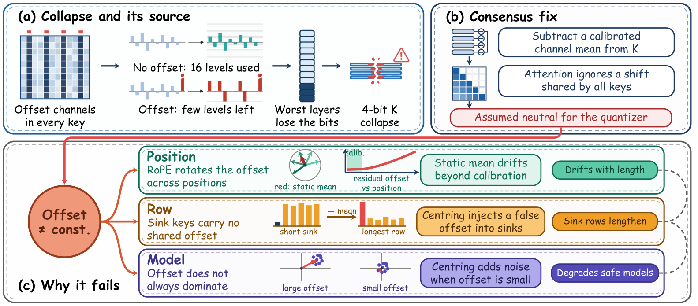
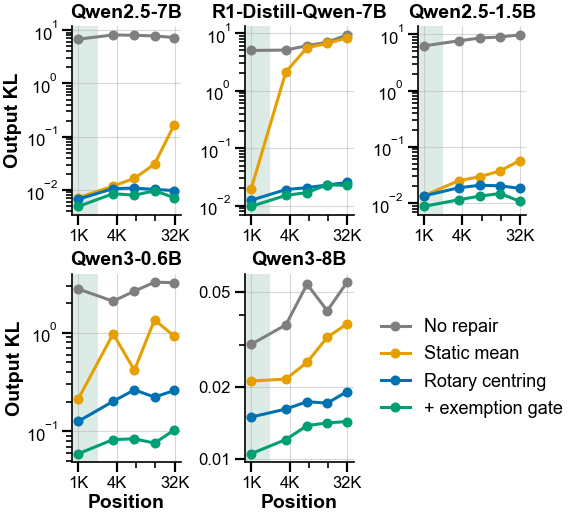
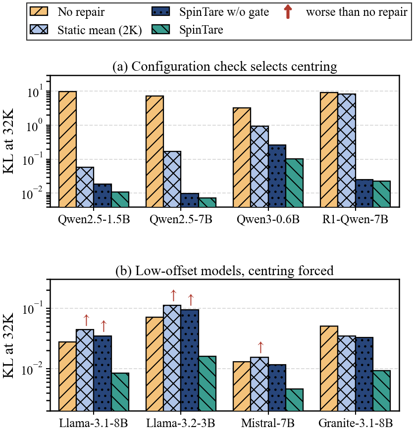
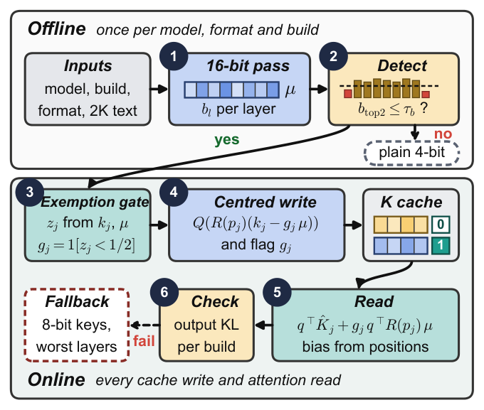

<div align="center">

# SpinTare

### Detect and fix offset-induced 4-bit K-cache collapse in LLMs

[](docs/setup.md)
[](docs/setup.md)
[](integrations/patches/llama.cpp)
[](integrations/vllm)
[](LICENSE)
[](docs/history.md)

[Setup](docs/setup.md) &nbsp;|&nbsp; [Reproduction](docs/reproduction.md) &nbsp;|&nbsp;
[Architecture](docs/architecture.md) &nbsp;|&nbsp; [vLLM](integrations/vllm/README.md) &nbsp;|&nbsp;
[Tools](docs/spintare_tools.md) &nbsp;|&nbsp; [History](docs/history.md)

</div>

---

## The problem

Quantizing the KV cache to 4-bit keys can silently break certain LLMs: there is no runtime error, only collapsed
outputs. On LongBench, Qwen2.5-7B drops from 48.0 to 1.2 points under llama.cpp `q4_0`, and it fails similarly in
vLLM.

The root cause is a channel offset in the key vectors that is shared across tokens and wastes the quantizer's
dynamic range. A common workaround subtracts a calibrated static channel mean before quantization, assuming that
centring is harmless. In practice, naive centring breaks in three ways:

- **Position drift (RoPE).** RoPE rotates the offset with token position, so a static post-RoPE mean stops matching
  beyond its calibration window.
- **Attention-sink rows.** Sink tokens do not share the offset; subtracting the mean increases their norm and their
  quantization error.
- **Low-offset models.** Models without a dominant shared offset get worse when they are centred.

## How SpinTare fixes it

SpinTare addresses all three failure modes while keeping the engine's native per-token block layout of the K
cache:

- **Configuration check (`b_top2`).** One 16-bit pass measures the effective bits of each layer in the engine's
  exact coordinates and takes the energy mean of the two worst layers (`b_top2`). Only (model, K format) pairs
  below the threshold (`tau_b = 2.028`) enable centring; the others run plain 4-bit.
- **Rotary centring with exact add-back.** Subtract the pre-RoPE channel mean `mu` before quantization, then
  restore the exact rotated bias `q . R(p) mu` in the attention score at read time.
- **Parameter-free exemption gate.** At write time, any row with `z = 1 - k.mu / |mu|^2 >= 0.5` (such as an
  attention sink) is left uncentred and marked with a row flag.

<p align="center">
  
</p>

## Key results

| Metric | Highlight | Details |
|---|---|---|
| Prevalence of collapse | 12 of 28 released models collapse under llama.cpp `q4_0`; 16 stay nearly lossless. | `experiments/spintare/detection_gate/` |
| Long-context stability (32K) | On the 5 models that need centring (teacher-forced `q4_0`, no rotation), a 2K static mean has 2.6-366x the output KL of SpinTare and trails by up to 32.0 points on downstream tasks. | `experiments/spintare/long_context_lc1/`, `experiments/spintare/tasks/` |
| Retrieval (RULER 32K) | Qwen2.5-7B: no repair **0.00**, SmoothAttention **0.00**, SpinTare **82.90** in llama.cpp (16-bit 82.78) and **80.90** in vLLM INT4 (16-bit 82.97). | `experiments/spintare/tasks/` |
| Reasoning (R1-Distill-Qwen-7B) | GSM8K: **0.0%** (no repair) / 77.5% (static mean) / **93.5%** (SpinTare) vs. 94.0% (16-bit). MATH-500: 0.0% / 52.8% / **84.8%** vs. 83.2% (16-bit). | `experiments/spintare/tasks/`, `experiments/results/spintare/reasoning_r1/` |
| KV memory | Matches 16-bit reasoning accuracy with **1.9x** (GSM8K) and **1.8x** (MATH-500) less KV memory per generation. | `experiments/results/spintare/reasoning_r1/` |
| Configuration check | `tau_b = 2.028`, fitted on 29 models / 60 cells: leave-one-family-out balanced accuracy **0.967**; **32/32** held-out cells (12 models) correct. | `experiments/spintare/prospective/`, `experiments/analysis/spintare/z_analyses.py` |

**Runtime and memory overhead** (one NVIDIA RTX 5090 D, batch 1, K `q4_0` / V `q8_0`):

- **Decode speed.** Rotary add-back slows decoding by 2.8-11.2%; the exemption gate costs a further 1.4-4.2
  percentage points (5.6-14.4% combined; `experiments/results/spintare/decode_overhead/res_ov2_time_agg.json`,
  `res_sg2_time_agg.json`).
- **K-cache memory.** The F32 row flags of the exemption gate add 5.6% to the K cache
  (`experiments/spintare/decode_overhead/`).

<table>
  <tr>
    <td width="50%" align="center"><br>
      <sub><b>A static mean drifts beyond its calibration window</b> (shaded). Output KL up to 32K on the five
      models that need centring: rotary centring stays flat, and the exemption gate lowers it further.</sub></td>
    <td width="50%" align="center"><br>
      <sub><b>Accuracy vs. KV memory per generation</b> (R1-Distill-Qwen-7B, llama.cpp). Collapsed caches loop
      until they hit the token limit; SpinTare keeps 16-bit generation lengths.</sub></td>
  </tr>
  <tr>
    <td width="50%" align="center"><br>
      <sub><b>Effect of each repair component at equal bit width</b> (32K output KL). (a) Models flagged for
      centring. (b) Low-offset models with centring forced: centring without the gate gives a higher output KL
      than no repair (red arrows).</sub></td>
    <td width="50%" align="center"><br>
      <sub><b>End-to-end workflow.</b> Offline, one 16-bit pass computes <code>b_top2</code> per model and
      format. Online, the exemption gate decides per row whether to centre, and the read path restores the
      rotated offset from token positions.</sub></td>
  </tr>
</table>

## Repository layout

| Component | Path | Description |
|---|---|---|
| llama.cpp patch (SpinTare) | [`integrations/patches/llama.cpp/spintare-rotary-addback-exemption-gate.patch`](integrations/patches/llama.cpp) | Rotary add-back computed from positions inside the flash-attention kernel; fused write kernels (`GGML_OP_KV_MU_GATE`) with F32 row flags. |
| llama.cpp patch (baseline) | `integrations/patches/llama.cpp/postmean-static-mean.patch` | Static post-RoPE mean baseline. |
| vLLM patch and plugin | [`integrations/patches/vllm/`](integrations/patches/vllm), [`integrations/vllm/`](integrations/vllm) | Triton add-back kernel patch and the `spintare_vllm` plugin (`SPINTARE_AB` backend, `calib-mu`, check, KL evaluation). |
| Core Python package | `src/spintare/` | Configuration and engine checks, calibration and mean-file tools, ggml reference quantizers, baselines. |
| Configuration selector (`kvsel`) | `src/kvsel/`, [`docs/kvsel/README.md`](docs/kvsel/README.md) | Maps a 16-bit probe and a deployment budget to a safe KV-cache configuration (format, repair, fallback), with an evidence status for every rule. |
| Experiments and results | `experiments/spintare/`, `experiments/results/`, `experiments/analysis/` | Per-study runners, frozen results, and CPU scripts that re-derive the tables and figures. |

## Installation

```bash
git clone https://github.com/small-amumu/SpinTare.git && cd SpinTare
python -m venv .venv && . .venv/bin/activate
pip install -e ".[test,layout,figures]"
pytest -q tests                                   # CPU unit tests
experiments/scripts/build_llama_cpp.sh all 120    # llama.cpp 3bb63cb: SpinTare, upstream and postmean trees
```

For vLLM: check out commit `5cb0fd265`, apply `integrations/patches/vllm/spintare-addback.patch`, install vLLM, then
run `pip install -e integrations/vllm` (see [`integrations/vllm/README.md`](integrations/vllm/README.md)).

All paths are configured in [`experiments/scripts/env.sh`](experiments/scripts/env.sh) (defaults under `work/`);
see [`docs/setup.md`](docs/setup.md).

## Quick start

### llama.cpp

```bash
. experiments/scripts/env.sh
M=$KVREL_MODELS/Qwen2.5-7B-Instruct
# 1. Configuration check: one 16-bit pass in engine coordinates, then b_top2
python experiments/spintare/detection_gate/kvprobe_unified.py --model $M --order hf \
    --out probe.json --text experiments/data/long_text.txt
python experiments/spintare/detection_gate/config_check.py probe.json --formats hadamard/q4_0
#   hadamard/q4_0      b_top2  0.2001  tau_b 2.028  -> centre  (worst layers [0, 27])
# 2. Calibrate the pre-RoPE mean on the first 2048 tokens, then serve with SpinTare
python experiments/spintare/calib_and_diag/mu_calib.py $M experiments/data/long_text.txt qwen25_7b.kvmu --T 2048
LLAMA_KV_DEBIAS_MU=qwen25_7b.kvmu LLAMA_KV_DEBIAS_MU_PATH=kqpos LLAMA_KV_MU_GATE=1 \
    $KVREL_LLAMA_CPP/build/bin/llama-server -m qwen25_7b-q8_0.gguf -fa on -ctk q4_0 -ctv q8_0
# 3. Optional: check the output KL in the engine against the 16-bit cache
python -m spintare check $KVREL_LLAMA_CPP_PM/build/bin qwen25_7b-q8_0.gguf experiments/data/long_text.txt
```

Llama-family GGUFs permute the q / k channels: probe with `--order gguf` and reorder calibrated mean files with
`python -m spintare permute`.

### vLLM

```bash
python -m spintare_vllm calib-mu $M experiments/data/long_text.txt m.kvmr
SPINTARE_KVMU=m.kvmr vllm serve $M \
    --attention-backend SPINTARE_AB --kv-cache-dtype int4_per_token_head
```

To include vLLM's INT4 block in the configuration probe, run `experiments/spintare/detection_gate/kvprobe_pth.py`.

## Reproducing the results

[`docs/reproduction.md`](docs/reproduction.md) maps every table and figure to its runner script, its frozen data
and the GPU it ran on.

Re-derive all aggregates and tables on a CPU (no GPU or models needed):

```bash
experiments/scripts/stage_results.sh
python experiments/analysis/spintare/z_analyses.py            # tau_b = 2.028, LOFO BA 0.967, ablations
FIG_OUT=work/figures python experiments/analysis/spintare/figures/make_eval_tables.py
```

Re-run individual GPU task cells:

- llama.cpp (with `GGUF`, `HF`, `MU`, `RULER_DATA` set):
  `experiments/spintare/tasks/run_llamacpp_cell.sh ruler spintare qwen25_7b`
- vLLM (with `HF`, `MU`, `MML`, `RULER_DATA` set): `experiments/spintare/tasks/run_vllm_cell.sh ruler spintare qwen25_7b`

`DRY_RUN=1` prints the exact server and client commands of a cell without running it.

The engine task evaluations and the decode-cost benchmarks ran on an NVIDIA RTX 5090 D and an RTX PRO 5000; the
hardware of every result is listed in [`docs/reproduction.md`](docs/reproduction.md).

## Scope and limitations

- **Research code.** Interfaces are not guaranteed to be stable; the experiment scripts keep the exact protocol of
  the registered runs (fixed seeds, frozen thresholds, md5 records).
- **Exemption gate coverage.** Evaluated inside the serving engine on two Qwen models and one GPU. The row flags
  are not yet carried through state save / load or context shift.
- **Engines and architectures.** Add-back is implemented for llama.cpp (Qwen2, Qwen3 and GPT-NeoX graphs with
  whole-head RoPE) and for vLLM's per-token-head caches (model types `llama`, `mistral`, `qwen2`, `qwen3` via
  `calib-mu`). Mixture-of-experts models and TensorRT-LLM have not been tested.

## License

Released under the [Apache License 2.0](LICENSE). The llama.cpp patches are derivative works of llama.cpp (MIT)
and the vLLM patch is a derivative work of vLLM (Apache-2.0); see [`docs/NOTICE`](docs/NOTICE) and
[`docs/THIRD_PARTY_NOTICES.md`](docs/THIRD_PARTY_NOTICES.md).

## Citation

If you use this software, please cite the repository (metadata in [`CITATION.cff`](CITATION.cff)):

```bibtex
@misc{spintare2026,
  title        = {{SpinTare}: Detection and Mitigation of Offset-Induced {K}-Cache Collapse},
  author       = {Hu, Zijie},
  year         = {2026},
  note         = {Software, version 0.1.0},
  howpublished = {\url{https://github.com/small-amumu/SpinTare}}
}
```
