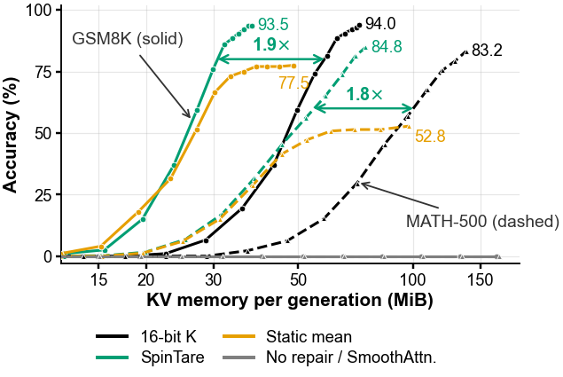

<div align="center">

# SpinTare

### Efficient detection and mitigation of offset-induced K-cache collapse

[](docs/setup.md)
[](docs/setup.md)
[](patches/llama.cpp)
[](integrations/vllm)
[](LICENSE)
[](docs/history.md)

[Setup](docs/setup.md) &nbsp;|&nbsp; [Reproduction](docs/reproduction.md) &nbsp;|&nbsp;
[Architecture](docs/architecture.md) &nbsp;|&nbsp; [vLLM](integrations/vllm/README.md) &nbsp;|&nbsp;
[Tools](docs/spintare_tools.md) &nbsp;|&nbsp; [History](docs/history.md)

</div>

---

Four-bit K caches collapse some models without any error: on LongBench, Qwen2.5-7B drops from 48.0 to
1.2 points under llama.cpp `q4_0`, and it fails similarly in vLLM. The cause is a key
offset shared across tokens. The usual fix subtracts a calibrated channel mean and assumes that centring
is neutral for the quantizer. It is not, in three ways:

- **Position.** RoPE rotates the offset, so a static mean drifts beyond its calibration window.
- **Row.** Attention-sink rows carry no offset; centring lengthens them and their quantization error.
- **Model.** Models without a dominant offset get worse when they are centred.

**SpinTare** answers each one: **rotary centring with exact add-back** (subtract the pre-RoPE mean before
quantization and restore `q . R(p) mu` exactly in the attention score), a parameter-free **exemption
gate** that leaves rows with `z = 1 - k.mu / |mu|^2 >= 0.5` uncentred, and a **configuration check**
(`b_top2`, the energy mean of the effective bits of the two worst layers, from one 16-bit pass) that decides per model and K
format whether to centre at all. The repair keeps the engine's per-token block layout of the K cache.

<p align="center">
  
</p>

## Results at a glance

| | Result | Where |
|---|---|---|
| Collapse | 12 of 28 released models collapse under llama.cpp `q4_0`; 16 stay nearly lossless | `experiments/spintare/detection_gate/` |
| Long context | at 32K (teacher forcing, `q4_0` without rotation), a 2K static mean leaves **2.6-366x** the output KL of SpinTare on the five models that need centring, and trails by up to 32.0 points on downstream tasks | `experiments/spintare/long_context_lc1/`, `experiments/spintare/tasks/` |
| Retrieval | RULER 32K, Qwen2.5-7B: no repair **0.00**, SpinTare **82.90** in llama.cpp (16-bit 82.78) and **80.90** in vLLM INT4 (16-bit 82.97); SmoothAttention stays at 0 | `experiments/spintare/tasks/` |
| Reasoning | R1-Distill-Qwen-7B, GSM8K: no repair **0.0%**, static mean 77.5%, SpinTare **93.5%** (16-bit 94.0%); MATH-500: 0.0% / 52.8% / **84.8%** (16-bit 83.2%) | `experiments/spintare/tasks/`, `results/spintare/reasoning_r1/` |
| Memory | SpinTare matches 16-bit accuracy with **1.9x** (GSM8K) and **1.8x** (MATH-500) less KV memory per generation | `results/spintare/reasoning_r1/` |
| Configuration check | threshold `tau_b = 2.028` fitted on 29 models / 60 cells: leave-one-family-out balanced accuracy **0.967**; all **32 held-out cells** (12 models) correct | `experiments/spintare/prospective/`, `analysis/spintare/z_analyses.py` |

Costs, measured on one RTX 5090 D at batch 1: rotary add-back slows decoding by 2.8-11.2%, the exemption
gate by a further 1.4-4.2 points (together 5.6-14.4% with K `q4_0` / V `q8_0`;
`results/spintare/decode_overhead/res_ov2_time_agg.json`, `res_sg2_time_agg.json`), and its F32 row
flags add 5.6% to the K memory
(`experiments/spintare/decode_overhead/`).

<table>
  <tr>
    <td width="50%" align="center"><br>
      <sub><b>A static mean stops working beyond its calibration window</b> (shaded). Output KL along
      32K on the five models that need centring; rotary centring stays flat, the exemption gate
      lowers it further.</sub></td>
    <td width="50%" align="center"><br>
      <sub><b>Accuracy against KV memory per generation</b> (R1-Distill-Qwen-7B, llama.cpp). A
      collapsed cache loops until the budget runs out; SpinTare keeps 16-bit generation lengths.</sub></td>
  </tr>
  <tr>
    <td width="50%" align="center"><br>
      <sub><b>Each repair step at equal bits</b>, output KL at 32K. (a) Models the configuration check
      sends to centring. (b) Low-offset models with centring forced: centring without the gate is worse
      than no repair (red arrows).</sub></td>
    <td width="50%" align="center"><br>
      <sub><b>Workflow.</b> Offline, one 16-bit pass evaluates <code>b_top2</code> per model and format.
      Online, the exemption gate decides per row whether to centre, the cache stores the centred or
      plain key with a flag, and the read path restores the rotated offset from positions.</sub></td>
  </tr>
</table>

## What is in this repository

| Part | Path |
|---|---|
| llama.cpp patch: rotary add-back (computed from positions inside the flash-attention kernel) + exemption gate (fused write kernels, F32 row flags) | [`patches/llama.cpp/spintare-rotary-addback-exemption-gate.patch`](patches/llama.cpp) |
| llama.cpp patch: static post-RoPE mean (the static-mean baseline) | `patches/llama.cpp/postmean-static-mean.patch` |
| vLLM: Triton add-back patch + plugin (`SPINTARE_AB` backend, `calib-mu`, check, KL pass) | [`patches/vllm/`](patches/vllm), [`integrations/vllm/`](integrations/vllm) |
| Python package `spintare`: configuration check and engine check, mean files, layout tools, baselines | `spintare/` |
| One folder per study: probes and model sets, task runners, simulations, decode timing | `experiments/spintare/` |
| Frozen results behind the tables and figures, re-derived on a CPU (coverage in [docs/reproduction.md](docs/reproduction.md)) | `results/spintare/`, `analysis/spintare/` |
| `kvsel`: probe -> KV-cache configuration selector (K format, repair, fallback per engine), its offline check and the X5 add-back check ([docs/kvsel/README.md](docs/kvsel/README.md)) | `kvsel/`, `analysis/kvsel/`, `experiments/kvsel/`, `results/kvsel/` |

## Install

```bash
git clone <this repository> spintare && cd spintare
python -m venv .venv && . .venv/bin/activate
pip install -e ".[test,layout,figures]"
pytest -q tests                                   # CPU unit tests
scripts/build_llama_cpp.sh all 120                # llama.cpp 3bb63cb: SpinTare, upstream, postmean trees
```

vLLM: check out commit `5cb0fd265`, `git apply patches/vllm/spintare-addback.patch`, install it, then
`pip install -e integrations/vllm` ([details](integrations/vllm/README.md)). All paths come from
[`scripts/env.sh`](scripts/env.sh) (defaults under `work/`); see [docs/setup.md](docs/setup.md).

## Quick start

```bash
. scripts/env.sh
M=$KVREL_MODELS/Qwen2.5-7B-Instruct
# 1. configuration check: one 16-bit pass in the engine's coordinates, then b_top2 per K format
python experiments/spintare/detection_gate/kvprobe_unified.py --model $M --order hf \
    --out probe.json --text data/long_text.txt
python experiments/spintare/detection_gate/config_check.py probe.json --formats hadamard/q4_0
#   hadamard/q4_0      b_top2  0.2001  tau_b 2.028  -> centre  (worst layers [0, 27])
# 2. pre-RoPE mean on the first 2048 tokens, then serve with the repair
python experiments/spintare/calib_and_diag/mu_calib.py $M data/long_text.txt qwen25_7b.kvmu --T 2048
LLAMA_KV_DEBIAS_MU=qwen25_7b.kvmu LLAMA_KV_DEBIAS_MU_PATH=kqpos LLAMA_KV_MU_GATE=1 \
    $KVREL_LLAMA_CPP/build/bin/llama-server -m qwen25_7b-q8_0.gguf -fa on -ctk q4_0 -ctv q8_0
# 3. engine check of the formats (output KL against the 16-bit cache)
python -m spintare check $KVREL_LLAMA_CPP_PM/build/bin qwen25_7b-q8_0.gguf data/long_text.txt
```

Llama-family GGUFs permute q / k channels: probe with `--order gguf` and reorder mean files with
`python -m spintare permute`. In vLLM: `python -m spintare_vllm calib-mu $M data/long_text.txt m.kvmr`,
then `SPINTARE_KVMU=m.kvmr vllm serve $M --attention-backend SPINTARE_AB --kv-cache-dtype
int4_per_token_head`; `detection_gate/kvprobe_pth.py` adds vLLM's INT4 block to the probe.

## Reproducing the results

[docs/reproduction.md](docs/reproduction.md) maps every result and figure to the script that ran it, its
frozen result and the GPU. Everything that is an aggregate re-derives on a CPU:

```bash
scripts/stage_results.sh
python analysis/spintare/z_analyses.py            # tau_b = 2.028, LOFO BA 0.967, ablations
FIG_OUT=work/figures python analysis/spintare/figures/make_ch5_bars.py
```

The task tables run cell by cell, e.g. with `GGUF`, `HF`, `MU` and `RULER_DATA` set,
`experiments/spintare/tasks/run_llamacpp_cell.sh ruler spintare qwen25_7b` (llama.cpp), or with `HF`,
`MU`, `MML` and `RULER_DATA` set, `experiments/spintare/tasks/run_vllm_cell.sh ruler spintare
qwen25_7b` (vLLM); `DRY_RUN=1` prints the server and client commands of a cell.

The engine task tables and the decode-cost measurements ran on an NVIDIA RTX 5090 D and an RTX PRO
5000; the GPU of every result is listed in [docs/reproduction.md](docs/reproduction.md) and
the experiment READMEs.

## Scope and limitations

The exemption gate was evaluated in the engine on two Qwen models and one GPU. The row flags are not
carried through state save, load or context shift. Add-back exists for llama.cpp (Qwen2, Qwen3,
GPT-NeoX graphs, whole-head rotary) and for vLLM's per-token-head caches (model types `llama`,
`mistral`, `qwen2`, `qwen3`, which `calib-mu` accepts); mixture-of-experts models and TensorRT-LLM were
not tested. The interfaces are research code and not stable; scripts keep the protocol of the registered
run that produced each number (fixed seeds, frozen thresholds, md5 records).

## License

Apache License 2.0, see [LICENSE](LICENSE). The llama.cpp patches are derivative works of llama.cpp (MIT)
and the vLLM patch of vLLM (Apache-2.0); see [NOTICE](NOTICE) and
[THIRD_PARTY_NOTICES.md](THIRD_PARTY_NOTICES.md).

## Citation

If you use this software, please cite the repository ([CITATION.cff](CITATION.cff)):

```bibtex
@software{spintare2026,
  title   = {SpinTare: detection and mitigation of offset-induced K-cache collapse},
  author  = {{The SpinTare Authors}},
  year    = {2026},
  version = {0.1.0},
  url     = {https://github.com/small-amumu/SpinTare}
}
```

See also [CITATION.cff](CITATION.cff).
